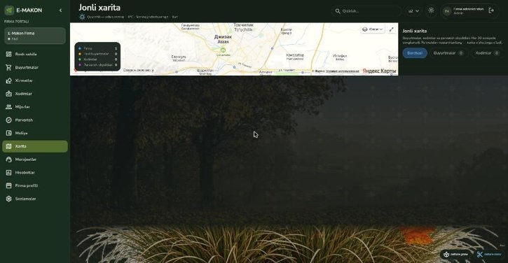
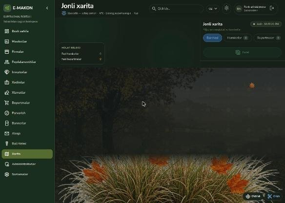
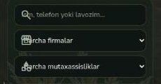
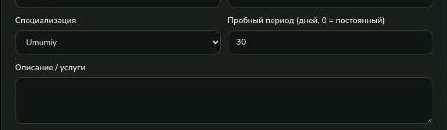
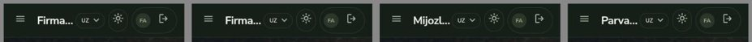
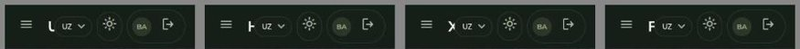
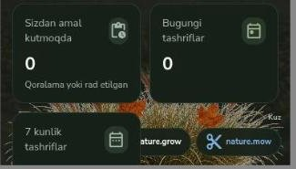
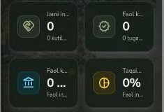
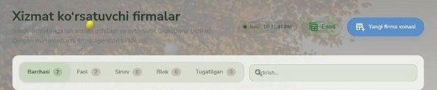
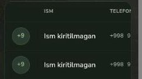

# E-Makon panellari — kamchiliklar ro'yxati

Tekshirilgan: `superadmin.e-makon.uz` (16 sahifa) va `admin.e-makon.uz` (12 sahifa), kompyuter va mobil (390px) kenglikda, 2026-11-11.

Tekshirilmagan: ma'lumot yaratish/o'zgartirish/o'chirish (jonli saytda test yozuvlar qoldirmaslik uchun), Excel/PDF yuklab olish, mobil ilova, Telegram bot. Jonli bazada buyurtma, xodim, investor yo'q — shu sababli to'ldirilgan jadvallar, buyurtma oqimi va moliya hisob-kitoblari ko'rinmadi.

## A. Ishlamayotgan yoki noto'g'ri ishlayotgan joylar

### 1. Firma panelida tarjima kalitlari ochiq ko'rinadi
Pastki o'ng burchakdagi tugmalarda matn o'rniga `nature.grow` / `nature.mow` chiqadi. `admin_panel/src/lib/i18n/messages.ts` da 12 ta kalit (`nature.*`, `scene.*`) faqat inglizchada bor; o'zbek, kirill va rus tillarida yo'q.

### 2. Firma panelida xarita ingichka tasma bo'lib qolgan
`/xarita` sahifasida xarita balandligi kompyuterda ~190px, qolgan joy bo'sh. Sabab: `h-[460px] … lg:h-auto` — katta ekranda balandlik bekor bo'ladi va konteyner siqiladi. Mobil kenglikda xarita to'g'ri chiqadi.

### 3. SuperAdmin panelida xarita umuman yo'q
`/xarita` sahifasida haqiqiy xarita ulanmagan: kodda faqat bo'sh fon ustiga nuqtalar chizish bor (`superadmin_panel/src/app/(admin)/xarita/page.tsx`). Firma panelida Yandex xarita ishlaydi, bu yerda esa yo'q.

### 4. Qidiruv va filtr maydonlarida ikonka matn ustiga chiqib qolgan
Ikkala panelning deyarli hamma sahifasida: lupa ikonkasi placeholder ustida, select ikonkasi "Barcha firmalar" yozuvi ustida. Sabab: `.emakon-input` klassi `pl-10` ni bekor qiladi — brauzerda chap chekinish 40px o'rniga 14px.

### 5. Til almashtirish faqat menyu va sarlavhani tarjima qiladi
Rus/ingliz tiliga o'tkazilganda sahifa ichidagi deyarli hamma matn o'zbekcha qoladi (kartalar, jadvallar, filtrlar, "Umumiy", "Kampaniya ulushi", "Hali buyurtma yo'q" va h.k.). SuperAdminda bor-yo'g'i 138 ta tarjima kaliti bor, sahifa matnlari kodga to'g'ridan-to'g'ri yozilgan.

### 6. Yuqoridagi umumiy qidiruv ko'p sahifada hech narsa qilmaydi
SuperAdminda sarlavhadagi "Qidirish…" maydoni faqat 8 sahifaga ulangan. Bosh sahifa, Hisobotlar, Foydalanuvchilar, Xodimlar, Bannerlar, Ball tizimi, Xarita, Sozlamalar va firma sahifasida yozgan matn hech narsaga ta'sir qilmaydi. Mobil kenglikda bu maydon butunlay yashirilgan.

### 7. Tunda "Quyoshli" deb chiqadi
Tunda (22:25) "Quyoshli — ochiq osmon" deb turibdi. Ob-havo jonli olinadi, lekin ochiq osmon uchun kun/tun farqlanmagan edi.

### 8. Kod tip tekshiruvidan o'tmaydi
`npx tsc --noEmit` xato beradi: `src/lib/weather/client.ts` (ikkala panelda, 77- va 88-qatorlar — `place` o'rniga `label`) va SuperAdmin `hisobotlar/page.tsx` 153–156 (`data` null bo'lishi mumkin). `next.config.ts` da tip xatolarini o'tkazib yuborish yoqilmagan, ya'ni shu kod bilan `npm run build` yiqilishi kerak (build'ni o'zim yurgizmadim).

### 9. Backend testlaridan 3 tasi xato beradi
146 testdan 3 tasi (`apps/orders/tests_payments.py`, `ProductionPaymentSettingsTests`) `DJANGO_ADMIN_ALLOWED_IPS` o'rnatilmagani uchun yiqiladi. Test o'zi kerakli muhit o'zgaruvchisini bermaydi.

## B. Mobil ko'rinishdagi kamchiliklar

### 10. Sahifa nomi kesilib qoladi
Firma panelida "Firma…", "Mijoz …", "Hisob…"; SuperAdminda torroq ekranda bitta harf qoladi ("U", "H", "X"). Til tanlash, mavzu, profil va chiqish tugmalari joyni egallab olgan.

### 11. Suzuvchi "o'stirish / o'rish" tugmalari kontentni yopadi
Pastki o'ngdagi bezak tugmalari kartalar va matn ustiga chiqadi (Mijozlar, Parvarish, firma sahifasi).

### 12. Statistik kartalar matni kesiladi
SuperAdmin Investorlar va Xodimlar sahifalarida: "Jami in…", "Faol k…", "0 …".

## C. Mantiqiy va matn kamchiliklari

### 13. Yorug' rejimda sarlavha o'qilmaydi
Sahifa sarlavhasi va tavsifi fon rasmi ustida deyarli ko'rinmaydi.

### 14. "Kampaniya ulushi" — "Kompaniya ulushi" bo'lishi kerak
SuperAdmin kodida 14 joyda "Kampaniya", 2 joyda "Kompaniya". Firma panelida xuddi shu narsa "Platforma ulushi" deb atalgan. Bitta nom tanlash kerak.

### 15. Ismsiz mijoz avatarida "+9" chiqadi
Ism bo'lmasa telefon raqamining boshi bosh harf sifatida olinadi.

### 16. Vaqt AQSh formatida
"Jonli · 10:25:29 PM" — o'zbek interfeysida 22:25:29 bo'lishi kerak. `toLocaleTimeString(undefined, …)` brauzer tilini oladi, panel tilini emas.

### 17. Menyu nomi va sahifa sarlavhasi mos emas
SuperAdmin: "Foydalanuvchilar" → sahifada "Mijozlar"; "Xodimlar" → "Firma xodimlari"; "Firmalar" → "Xizmat firmalari". Firma paneli: "Murojaatlar" → "Mijoz murojaatlari".

### 18. Bir xil so'rov bir necha marta yuboriladi
SuperAdmin Buyurtmalar sahifasi ochilganda `orders/availability` 2 marta, `orders/` ro'yxati 2–3 marta so'raladi; har sahifa almashganda `auth/me` va `services/?moderation_status=pending` qayta so'raladi.

### 19. Standart tashkilot firma sifatida ko'rinadi
"E-Makon" (id=1, tizimning o'zi) "Xizmat firmalari" ro'yxatida, hisobotlarda va buyurtma filtrlarida oddiy firma kabi turibdi. Ataylab qilinganmi — aniqlashtirish kerak.

## Yaxshi ishlayotgan joylar
- Barcha 28 sahifa ochiladi, API so'rovlarining hammasi 200 qaytardi, brauzer konsolida xato yo'q.
- Mobil kenglikda gorizontal siljish yo'q, yon menyu "gamburger"ga yig'iladi.
- Mavzu (qorong'u/yorug') almashadi, modal oynalar ochiladi.

## Tuzatish holati (lokal kodda, 2026-11-11)

Tuzatildi va lokal nusxada tekshirildi: 1, 2, 3, 4, 7, 8, 9, 10, 11, 13, 14, 15, 16.
- 6: qidiruv maydoni endi faqat o'zi ishlaydigan sahifalarda ko'rinadi (boshqa sahifalarga qidiruv qo'shilmadi).
- 13: taglik faqat `PageHeader` komponentini ishlatadigan sahifalarga qo'shildi.

- 5 (to'liq tarjima): ikkala panel rus, ingliz va o'zbek-kirill tillariga o'tkazildi. Sahifalar kodi o'zgarmadi — o'zbekcha matnlar render paytida lug'at orqali o'giriladi:
  - mexanizm: `src/lib/i18n/auto/` (maxsus JSX runtime, `tsconfig.json` dagi `jsxImportSource`);
  - lug'at manbasi: `tools/i18n/*.tsv` (1680 yozuv), `python3 tools/i18n-build.py` ikkala panel uchun `dict.ts` yaratadi;
  - yangi matnlarni yig'ish: `node tools/i18n-extract.cjs <panel>`;
  - lug'atda yo'q matn o'zbekcha qoladi. Serverdan keladigan ma'lumotlar (ismlar, manzillar, xizmat nomlari va tavsiflari, mijoz izohlari) tarjima qilinmaydi; Excel/PDF eksport ichidagi matnlar ham o'zbekcha.

Tuzatilmadi: 12, 17, 18, 19.

Jonli saytga hech narsa chiqarilmadi. SuperAdmin xaritasi jonli saytda ishlashi uchun uning build'iga ham `NEXT_PUBLIC_YANDEX_MAPS_KEY` berilishi kerak.
